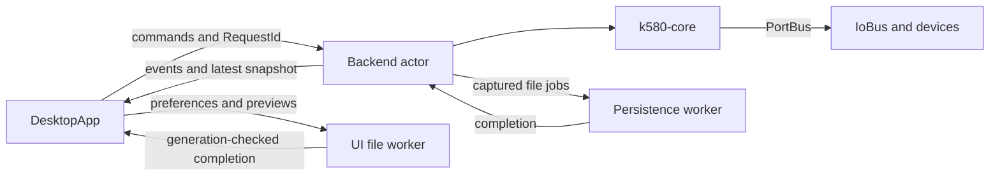

# Architecture

The workspace separates deterministic CPU execution from the desktop application.
Start with the [documentation index](README.md) for task-specific guides.

## Crates

| Crate | Responsibility |
|---|---|
| `k580-core` | CPU state/RAM, registers/flags, decoding, execution, interrupts, timing and `PortBus` |
| `kr580` | Iced application, backend actor, devices, persistence, launcher, installer and platform integration |

`crates/core` is the public processor library and has no Tokio/iced dependency
or unsafe code. `crates/ui` contains the binary-side `app`/`view` and library
modules used for desktop integration; some public modules are hidden in rustdoc.
Public error and integration APIs are documented in their corresponding guides.

Both packages inherit the workspace release version. Cargo manifests/lockfiles
are authoritative for versions, dependencies and feature flags; publishing
checks are in [Repository maintenance](maintenance.md#release-checks).

## Data flow

The actor owns CPU and device state. UI widgets render snapshots and keep local
drafts; all CPU/device mutation is submitted through typed commands.

Snapshots use a latest-state mailbox. Critical events preserve errors and
request-correlated completions separately, so dropping an intermediate RAM
snapshot cannot drop confirmation of a save or edit.

Backend errors retain their category, localization key and original cause.
Cloning an event preserves the source chain; Display text is diagnostic rather
than a dispatch key. Concrete persistence variants and `io::ErrorKind` determine
categories rather than platform-dependent numeric error codes.

## Workers and completions

| Owner | Work | Admission |
|---|---|---|
| CPU actor | Commands, paced/burst execution and device reconciliation | 256 queued commands; 1024 critical events with backpressure |
| Backend persistence worker | Snapshot/subprogram/import/export and storage opening | FIFO, at most eight waiting jobs |
| UI file worker | Settings read-modify-write, previews, image encoding and buffer exports | Eight active/queued/unconsumed jobs in total |
| Device runtime | Storage writers, TCP and native printing | Device-specific budgets in [Devices](devices.md) |

Frontend pending backend requests have their own 128-request limit. Full queues
return Busy without blocking admission or creating unbounded threads.
File-work panics are converted to failed completions rather than leaving a
request unresolved.

Every asynchronous effect carries its ownership context. Document generations
invalidate old loads/imports; per-device generations invalidate old storage opens
and previews. A superseded result cannot change CPU, paths, dirty markers or
notices, including through a late error.

Imports return validated patches and subprogram reads return owned byte blocks.
The actor applies those to its current CPU, retaining unrelated edits made
during I/O. Saves/exporters operate on their independently captured state.

UI CPU edits reserve an undo entry and fill it with the actor's actual change.
Metadata and sparse cells avoid unnecessary full RAM copies; dense changes can
retain checkpoints. Only a matching completion advances saved document state.
See [UI event handling](ui_app.md#event-handling).

Settings operations read the latest file and apply their owned change in FIFO
order. Event handlers use a confirmed settings cache; external file edits are
picked up on the next background read-modify-write or startup.

Storage opening occurs on the persistence worker, then the actor installs the
owned open file. Reattachment reuses a writer and flushes accepted bytes before
switching files. File-association work uses a blocking task and one pending flag
that outlives its settings dialog.

## Actor pacing

`backend/actor.rs` selects among commands, the run deadline, a 50 ms device timer
and file completions.

- Paused: only the run deadline is disabled. Device polling and I/O completion
  handling continue, including while no command is submitted.
- Paced: the run deadline advances one instruction at the selected interval.
- Burst: one tick runs an instruction batch bounded by a wall-time slice,
  HLT/error or the per-arming instruction budget, then publishes its final state.

The run deadline is an absolute Instant and is preserved across device polls.
Polling therefore does not repeatedly restart a slow execution interval.
Commands are reconsidered between batches; this provides responsiveness without
promising a strict real-time bound under queueing or OS scheduling.

Device polling drains storage/printer results and compares network revision
before constructing a snapshot. Unchanged polls copy neither RAM nor retained
device buffers. Publication captures its baseline before snapshot construction,
so concurrent network changes are detected on the next poll.

The UI initializes the actor's mode/interval from the saved speed.
UI refresh cadence is independent and can coalesce intermediate states.
See [run modes](ui_execution.md#run-modes-and-speed).

## Confirmed shutdown

UI close/restart waits for accepted frontend work, then submits backend Shutdown.
The actor places a FIFO barrier on persistence and reconciles earlier completions.
It then joins all accepted storage and printer writes before acknowledging.
A device failure is reported after the other writers are also drained.

Successful explicit shutdown ends the actor after its receipt. Channel
disconnection uses the fallback post-loop drain. The main window and iced daemon
exit after confirmation; failure leaves inspection and retry available.
See [UI exit](ui_app.md#confirmed-application-exit) and
[device shutdown](devices.md#confirmed-shutdown) for the respective contracts.

## Native boundaries and distribution

Blocking filesystem, socket and driver work stays outside the UI thread.
Printer COM/provider guards remain on their owning thread; registry/dialog
buffers are validated before native access. Platform helpers isolate Windows
presentation and macOS document activation.

Filesystem formats and atomic-write guarantees belong to
[Persistence](persistence.md). Installation layout, native ownership/rollback and
distribution commands belong to [Installer](installer.md), with
[Linux packages](linux_packages.md) for RPM/Arch. Artwork source and embedding
belong to [Assets](assets.md); update policy and staging belong to
[Updates](updates.md).
